## Hi there 👋,I'm JinKang
I love to talk on trending ⚡ technology ⚡, stay hungry

<h3> 👨🏻‍💻 &nbsp;About Me </h3>

- 🤔 &nbsp; For engineers building LLM applications, what matters most is being pragmatic.
- 🌱 &nbsp; I want to build more Harnesses—and through them, fully unlock the capabilities of models.
- 📚 &nbsp; Enjoying reading and accumulating knowledge
- 📖 &nbsp; Novels: *《剑来》* and *《雪中悍刀行》*
- 📺 &nbsp; Cartoon: *One Piece* and *《一人之下》* and *《星游记》*
- 🔗 &nbsp; Want to know more? Check out my blog: [EN](<EN_BLOG_URL>), [中文](<ZH_BLOG_URL>).

[
]()

### 🛰️ What I'm Exploring  
- Multi-agent collaboration is a long-term challenge. Like context management, it is fascinating and worth exploring.
- Agent evaluation is the foundation for continuously improving Agents—and the starting point for everything good. 
- Anything Worth Learning and Building: Open source, English, LLM inference infrastructure, Coding Agents,

### 🌴 Building Now
- 🌈 [大模型应用开发 -上下文工程与运行空间实践指南](https://github.com/WakeUp-Jin/Practical-Guide-to-Context-Engineering) - Context engineering is the design principle; Agent Harness is the build target
- 🪐 [Actspace Agent](https://github.com/WakeUp-Jin/actspace-agent) - A local Agent desktop app and Harness for models, starting from a Coding Agent
- 🍍 [agent-harness-dev](https://github.com/WakeUp-Jin/agent-harness-dev) -  A Skill for building Agent backends
- 🚄 [code-develop-harness-init](https://github.com/WakeUp-Jin/code-develop-harness-init) - A project init template (Harness) for Agent-first development
- 🎶 [音频制作Agent](https://github.com/WakeUp-Jin/reasonVoiceAgent-introduction) -  An AI-driven audio platform for voice-over, sound effects, and BGM
- 🌵 [Reason Code](https://github.com/WakeUp-Jin/reason-code) - Reason Code is a coding Agent that runs in your terminal
- 🦾 [HeartClaw](https://github.com/WakeUp-Jin/heartclaw) - A self-evolving personal AI Agent with long- and short-term memory, autonomous patrols, and self-forged tools

### 🍏 Contact 
公众号「锦康灵感铺」 · 微信号「a2385472291」 · 2385472291@qq.com · [稀土掘金](https://juejin.cn/user/4224735995759975) · [小红书](https://www.xiaohongshu.com/user/profile/5f2b55730000000001005a90)
> 我目前对新的机会保持开放。如果你的团队在做大模型应用 /Agent 相关产品，或者只是想交流想法、都非常欢迎随时找我聊聊 
